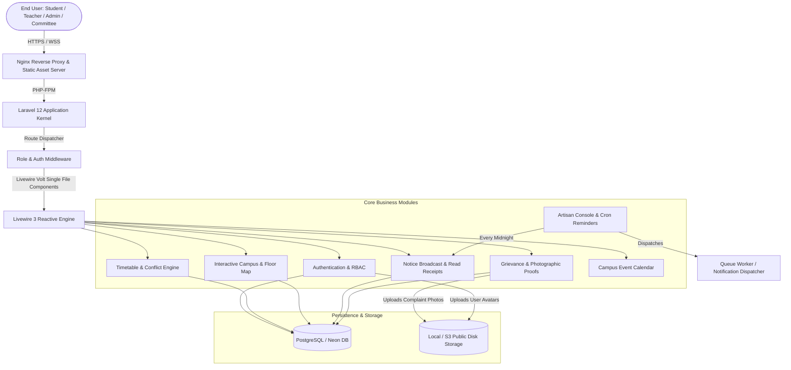
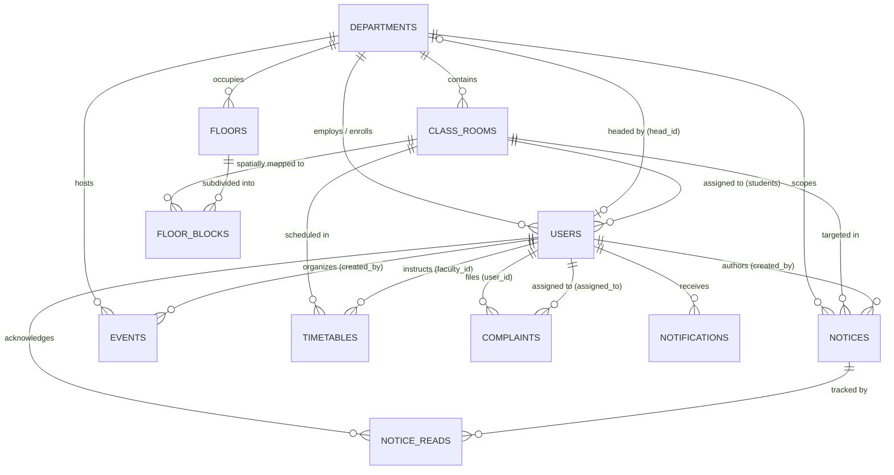
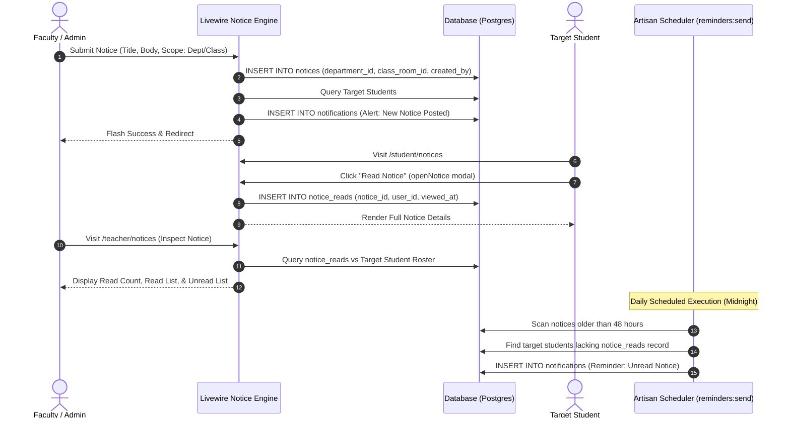
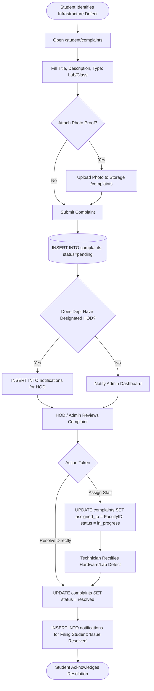
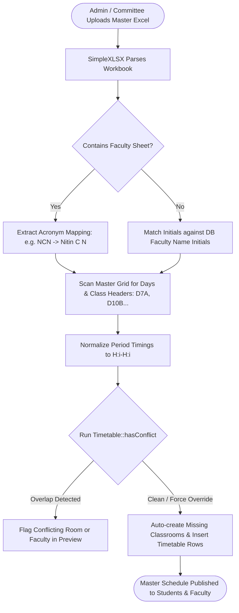

# Campus Companion — Comprehensive Project Technical Specification & Black Book Master Context

> **Document Version:** 1.0.0  
> **Target Audience:** Academic Evaluators, Final Year Project Reviewers, AI Assistants (Claude, GPT, Gemini) for Black Book / Dissertation Generation  
> **Institution:** Vivekanand Education Society's Institute of Technology (VESIT), University of Mumbai  
> **Project Scope:** Enterprise Campus ERP, Scheduling, Grievance Management, Read-Tracked Communication & Indoor Spatial Navigation Ecosystem  

---

## 1. Executive Summary & Project Abstract

### 1.1 Project Title
**Campus Companion: An Intelligent, Role-Governed Campus Management, Master Scheduling, Indoor Navigation, and Grievance Redressal Ecosystem**

### 1.2 Abstract
Modern tertiary educational institutions manage high volumes of dynamic operational data: departmental academic schedules, physical classroom allocations, urgent administrative announcements, campus-wide events, and physical infrastructure grievances. Conventional campus management setups typically rely on fragmented legacy portals, manual bulletin boards, WhatsApp groups, and uncoordinated spreadsheets. This fragmentation results in timetable collisions, communication blackouts, delayed resolution of lab/classroom defects, and cognitive disorientation for newcomers navigating multi-story academic buildings.

**Campus Companion** resolves these challenges through a unified, reactive web application built on **Laravel 12**, **Livewire 3 (Volt)**, **Tailwind CSS v4**, **Alpine.js**, and **PostgreSQL (Neon Serverless)**. Key innovations include:
1. **Intelligent Master Timetable & Conflict Engine**: Algorithmic detection of faculty and room overlapping across 24-hour and standard period slots, combined with a multi-sheet Excel/CSV parser (`Shuchkin/SimpleXLSX`) that maps faculty acronyms, creates classrooms, and populates master matrices in seconds.
2. **Context-Aware Clash Recovery**: Faculty-facing clash reporter that detects busy rooms in real time and queries the spatial floor database to recommend available alternative rooms on the same floor or department.
3. **Multi-Tier Notice Broadcast & Accountability Tracking**: Granular notice scoping (Campus-wide, Department-specific, or Class-specific) coupled with an unread tracking engine (`notice_reads`) and an automated cron dispatcher (`php artisan reminders:send`) that notifies students whose required notices remain unread after 48 hours.
4. **Photographic Grievance Redressal Workflow**: Students raise lab/classroom hardware issues with photo proofs, automatically routed to the respective Department Head (HOD) and assigned to staff members with status transitions (`pending` $\rightarrow$ `in_progress` $\rightarrow$ `resolved`).
5. **Interactive 2D Campus & Multi-Floor Spatial Indoor Map**: Interactive SVG-rendered campus layout with building-level wayfinding, integrated with floor plans composed of scalable coordinate grid blocks ($X, Y, W, H$) linked to active classrooms.
6. **Role-Based Dynamic UX**: Strictly partitioned access control supporting **Admin**, **Timetable Committee**, **Teacher / HOD**, and **Student** personas wrapped in an ultra-modern aesthetic supporting reactive Dark/Light themes, glassmorphism, animated canvas particle systems, and Font Awesome 6.5 iconography.

---

## 2. Technical Stack & Architectural Paradigms

| Component | Technology | Version / Specification | Rationale & Responsibility |
| :--- | :--- | :--- | :--- |
| **Backend Framework** | Laravel | `^12.0` (PHP 8.2+) | Robust MVC foundation, Eloquent ORM, queued jobs, Artisan CLI, route middleware, and native session management. |
| **Reactive Component Layer** | Livewire & Volt | `livewire/volt: ^1.6.7`, `livewire/flux: ^2.0` | Declarative single-file reactive UI components without writing external REST APIs or SPA boilerplates. |
| **Relational Database** | PostgreSQL / MySQL | PostgreSQL 16 (Neon Serverless) / MySQL 8.0 | Relational integrity, foreign key cascades, date-time indexing, and ACID transaction compliance. |
| **Styling & Design System** | Tailwind CSS & PostCSS | `tailwindcss: ^4.0.7`, `@tailwindcss/vite` | Modern utility-first CSS engine with dark mode styling, Syne & DM Sans typography, and custom micro-animations. |
| **Client-Side Reactivity** | Alpine.js | Embedded with Livewire 3 | Modal popovers, dropdown toggles, canvas background physics, and instant DOM interactions. |
| **Document/Spreadsheet Parsing**| SimpleXLSX | `shuchkin/simplexlsx: ^1.1` | High-performance, memory-efficient XLSX/CSV extraction engine for bulk master timetable ingestion. |
| **Iconography** | Font Awesome 6.5 | CDN / SVG vector icons | Consistent visual indicators across status badges, sidebars, navigation cards, and buttons. |
| **Testing Engine** | PHPUnit & Pest | PHPUnit `11.5.3`, Pest `^3.0` | Automated unit and integration test suites validating RBAC, scheduling collisions, notices, and grievances. |
| **Containerization & Hosting**| Docker & Nginx | `richarvey/nginx-php-fpm:3.1.6` | Multi-stage production container build deployed seamlessly to Render, Railway, or AWS ECS. |

---

## 3. High-Level System Architecture



---

## 4. Comprehensive Repository & Directory Structure

```plaintext
campus-companion/
├── .editorconfig                          # IDE code consistency rules
├── .env.example                           # Template environment configuration
├── .gitattributes                         # Git line-ending configuration
├── .gitignore                             # Git ignore rules
├── Dockerfile                             # Multi-stage production container build (Composer + Node + PHP-FPM)
├── README.md                              # Repository overview and setup guide
├── artisan                                # Laravel Artisan command-line executable
├── composer.json                          # PHP dependencies and package declarations
├── composer.lock                          # Locked PHP dependency versions
├── package.json                           # Node.js dependencies and build scripts (Vite, Tailwind)
├── package-lock.json                      # Locked Node dependencies
├── phpunit.xml                            # Testing suite environment and runner configuration
├── vite.config.js                         # Vite build configurations with Tailwind v4 plugin
│
├── app/
│   ├── Console/
│   │   └── Commands/
│   │       └── SendUnseenReminders.php    # Artisan command 'reminders:send' for unread notice escalation
│   ├── Http/
│   │   ├── Controllers/
│   │   │   └── Auth/
│   │   │       └── VerifyEmailController.php # Email verification link handler
│   │   └── Middleware/
│   │       └── RoleMiddleware.php         # RBAC guard: enforces role checks (admin, teacher, student, timetable_commity)
│   ├── Jobs/
│   │   └── SendUserCreatedMail.php        # Async job for sending credentials to newly created users
│   ├── Livewire/
│   │   └── Actions/
│   │       └── Logout.php                 # Safe session invalidation and user logout action
│   ├── Mail/
│   │   └── UserCreatedMail.php            # Mailable notification containing account credentials
│   ├── Models/
│   │   ├── ClassRoom.php                  # Class division model (year, name, department_id)
│   │   ├── Complaint.php                  # Issue / Grievance model (photos, status, assigned staff)
│   │   ├── Department.php                 # Department model (name, head_id, faculties, classrooms)
│   │   ├── Event.php                      # Campus / Departmental event announcements
│   │   ├── Floor.php                      # Campus building floor entity (level, department_id)
│   │   ├── FloorBlock.php                 # 2D Grid block within a floor (x, y, w, h, classroom link, color)
│   │   ├── Notice.php                     # Announcement entity (category, target scope, creator)
│   │   ├── NoticeRead.php                 # Accountability receipt model (user_id, notice_id, timestamps)
│   │   ├── Notification.php               # User notification entity (unread status, message)
│   │   ├── Timetable.php                  # Lecture schedule entry with mathematical overlap detection
│   │   └── User.php                       # Base user model with role helpers, relations, and avatar handling
│   ├── Providers/
│   │   └── AppServiceProvider.php         # Application bootstraps, pagination, and Neon SSL/SNI database patch
│   └── Services/
│       └── TimetableImportService.php     # Complex Excel/CSV timetable parser, initials mapper, clash detector
│
├── bootstrap/
│   ├── app.php                            # Laravel 12 application instance, route registrations, middleware alias
│   └── providers.php                      # Service provider registration manifest
│
├── config/
│   ├── app.php                            # Application name, timezone, encryption key, locale
│   ├── auth.php                           # Authentication guards, user providers, password reset tables
│   ├── database.php                       # DB drivers (PostgreSQL with SSL mode, SQLite, MySQL)
│   ├── filesystems.php                    # Public disk, local disk, S3 disk drivers
│   ├── logging.php                        # Stack, single, stderr, and syslog loggers
│   ├── mail.php                           # SMTP, log, and SES mailer configurations
│   ├── queue.php                          # Database, Redis, and sync queue drivers
│   └── session.php                        # Cookie and database session configuration
│
├── database/
│   ├── factories/
│   │   └── UserFactory.php                # Mock factory for automated unit and feature testing
│   ├── migrations/
│   │   ├── 0001_01_01_000000_create_users_table.php
│   │   ├── 0001_01_01_000001_create_cache_table.php
│   │   ├── 0001_01_01_000002_create_jobs_table.php
│   │   ├── 2026_04_14_132211_add_role_to_users_table.php
│   │   ├── 2026_04_14_151347_create_notices_table.php
│   │   ├── 2026_04_14_151348_create_events_table.php
│   │   ├── 2026_04_14_202134_create_timetables_table.php
│   │   ├── 2026_04_25_214425_create_complaints_table.php
│   │   ├── 2026_04_25_221203_create_notifications_table.php
│   │   ├── 2026_04_27_201352_add_profile_photo_to_users_table.php
│   │   ├── 2026_04_28_192805_create_departments_table.php
│   │   ├── 2026_04_28_193506_create_class_rooms_table.php
│   │   ├── 2026_04_28_193508_add_class_room_id_to_users_table.php
│   │   ├── 2026_04_28_193509_add_class_room_id_to_timetables_table.php
│   │   ├── 2026_04_28_194204_add_department_id_to_users_table.php
│   │   ├── 2026_04_28_211237_add_scope_to_notices_table.php
│   │   ├── 2026_04_28_211925_add_department_id_to_events_table.php
│   │   ├── 2026_04_28_222548_add_faculty_id_to_timetables_table.php
│   │   ├── 2026_04_28_223526_remove_faculty_from_timetables.php
│   │   ├── 2026_04_29_074054_add_assigned_to_to_complaints_table.php
│   │   ├── 2026_08_14_042843_add_photo_to_complaints_and_head_to_departments.php
│   │   ├── 2026_08_14_043707_create_notice_reads_table.php
│   │   ├── 2026_08_20_223000_create_floors_table.php
│   │   ├── 2026_08_20_223001_create_floor_blocks_table.php
│   │   └── 2026_08_21_120000_add_department_id_to_floors_table.php
│   └── seeders/
│       ├── ClassRoomSeeder.php            # Seeds FY/SY/TY divisions A & B across all departments
│       ├── ComplaintSeeder.php            # Seeds mock complaints with random statuses and types
│       ├── DatabaseSeeder.php             # Master seeder orchestrating initial data setup
│       ├── DepartmentSeeder.php           # Seeds engineering branches (CMPN, IT, Electronics, AI, Robotics)
│       ├── EventSeeder.php                # Seeds upcoming college campus events
│       ├── FloorSeeder.php                # Seeds Ground, 1st, 2nd floors and standard grid blocks
│       ├── NoticeSeeder.php               # Seeds initial administrative and academic notices
│       ├── TimetableSeeder.php            # Seeds complete weekly timetables with collision-free rotation
│       └── UserSeeder.php                 # Seeds Admin, Committee, Faculty, and Students
│
├── public/
│   ├── build/                             # Compiled CSS and JavaScript bundles (Vite outputs)
│   ├── favicon.ico                        # Application favicon
│   ├── index.php                          # HTTP entrypoint for web server / reverse proxy
│   └── robots.txt                         # Search engine crawler instructions
│
├── resources/
│   ├── css/
│   │   └── app.css                        # Tailwind CSS imports, theme variables, custom fonts
│   ├── js/
│   │   └── app.js                         # JavaScript entrypoint
│   └── views/
│       ├── components/
│       │   ├── action-message.blade.php   # Status transition alert toast
│       │   ├── app-logo.blade.php         # Application branding logo
│       │   ├── auth-header.blade.php      # Title and description header for auth screens
│       │   ├── notification-bell.blade.php# Interactive Alpine bell with live unread counter & dropdown
│       │   ├── report-clash-modal.blade.php# Timetable clash reporting modal with room alternative suggestions
│       │   ├── theme-toggle.blade.php     # Smooth dark/light mode toggle with localStorage persistence
│       │   ├── user-avatar.blade.php      # User photo component with initials fallback
│       │   └── layouts/
│       │       ├── admin.blade.php        # Navigation shell for Administrators and Committee members
│       │       ├── app.blade.php          # Generic dashboard layout wrapper
│       │       ├── auth.blade.php         # Clean wrapper for login and registration views
│       │       ├── student.blade.php      # Modern sidebar and bottom-bar layout for Students
│       │       └── teacher.blade.php      # Dashboard layout for Faculty with quick action triggers
│       ├── livewire/
│       │   ├── admin/
│       │   │   ├── classes/               # Class index, creation, and editing Volt components
│       │   │   ├── complaints/            # Admin grievance oversight and staff assignment Volt component
│       │   │   ├── dashboard.blade.php    # Admin analytics, total metrics, active notices, recent logs
│       │   │   ├── departments/           # Department CRUD and HOD designation Volt components
│       │   │   ├── events/                # Event creation and management Volt components
│       │   │   ├── map.blade.php          # Floor editor, coordinate grid block modifier, campus SVG map
│       │   │   ├── notices/               # Scoped notice authoring and modification Volt components
│       │   │   ├── timetable/             # Timetable editor, Master Grid view, and Bulk Excel/CSV Importer
│       │   │   └── users/                 # User CRUD, role assignment, and classroom enrollment Volt components
│       │   ├── auth/
│       │   │   ├── login.blade.php        # Dual-panel login with animated floating particle canvas
│       │   │   ├── register.blade.php     # Centered, mobile-responsive registration with animated canvas
│       │   │   ├── forgot-password.blade.php # Password recovery link dispatcher
│       │   │   └── reset-password.blade.php  # Token-verified password reset form
│       │   ├── settings/
│       │   │   ├── appearance.blade.php   # Theme customization preferences
│       │   │   ├── password.blade.php     # Secure password change component
│       │   │   └── profile.blade.php      # Profile photo upload, name, and email updater
│       │   ├── student/
│       │   │   ├── complaints/index.blade.php # Photo-supported grievance filing and history
│       │   │   ├── dashboard.blade.php    # Student schedule summary, scoped notices, upcoming events
│       │   │   ├── events/index.blade.php # Interactive student event browser
│       │   │   ├── map.blade.php          # 2D Campus wayfinder and multi-floor indoor classroom explorer
│       │   │   ├── notices/index.blade.php# Scoped notice board with read-receipt logger on open
│       │   │   ├── profile.blade.php      # Student profile, department badge, photo upload
│       │   │   └── timetable/index.blade.php # Weekly timetable grid with day switcher
│       │   └── teacher/
│       │       ├── complaints/index.blade.php # Departmental grievance view with status resolution
│       │       ├── dashboard.blade.php    # Faculty schedule overview, quick notice composer
│       │       ├── events/index.blade.php # Campus event directory
│       │       ├── map.blade.php          # Indoor campus and classroom locator
│       │       ├── notices/
│       │       │   ├── create.blade.php   # Notice creation with automatic student notifications
│       │       │   └── index.blade.php    # Real-time accountability stats (Read vs Unread student lists)
│       │       ├── profile.blade.php      # Faculty credential and avatar manager
│       │       └── timetable/index.blade.php # Teacher schedule with Clash Reporter & Alternative Room Finder
│       └── welcome.blade.php              # High-conversion public landing page with feature showcase
│
├── routes/
│   ├── auth.php                           # Guest authentication and password reset routes
│   ├── console.php                        # Artisan scheduler definitions ('reminders:send' daily schedule)
│   └── web.php                            # Protected application routes categorized by RoleMiddleware
│
├── scripts/
│   └── run.sh                             # Container deployment startup script (migrations & caching)
│
└── tests/
    ├── Feature/
    │   ├── Auth/                          # Authentication and email verification tests
    │   ├── CampusMapTest.php              # Floor switching, grid blocks, admin floor CRUD tests
    │   ├── ComplaintsTest.php             # Grievance submission, HOD alerts, teacher resolution tests
    │   ├── DepartmentsAndClassesTest.php  # Department and Classroom creation and validation tests
    │   ├── MasterTimetableImportTest.php  # XLSX timetable parser, time standardizer, master grid tests
    │   ├── NoticesTrackingTest.php        # Scoped notice views, read-receipts, and reminder command tests
    │   ├── RoleAccessTest.php             # RBAC guard enforcement across all personas
    │   ├── TimetableManagementTest.php    # Schedule collision detection and validation tests
    │   └── UserManagementTest.php         # User registration, editing, and credential tests
    └── TestCase.php                       # Base PHPUnit testing harness
```

---

## 5. Detailed Relational Database Schema & Data Dictionary

### 5.1 Entity Relationship Diagram (ERD)



---

### 5.2 Complete Table Definitions

#### 1. `users` Table
Stores authentication credentials, persona classifications, personal details, and departmental mappings.
| Column Name | Data Type | Nullable | Default | Constraints & Description |
| :--- | :--- | :--- | :--- | :--- |
| `id` | `BIGINT UNSIGNED` | NO | Auto Increment | Primary Key |
| `name` | `VARCHAR(255)` | NO | None | Full legal name of the user |
| `email` | `VARCHAR(255)` | NO | None | Unique user email address (login credential) |
| `email_verified_at`| `TIMESTAMP` | YES | `NULL` | Verification timestamp |
| `password` | `VARCHAR(255)` | NO | None | Bcrypt / Argon2id salted password hash |
| `role` | `VARCHAR(50)` | NO | `'student'` | Enum-style string: `admin`, `timetable_commity`, `teacher`, `student` |
| `profile_photo` | `VARCHAR(255)` | YES | `NULL` | Public storage relative path to user avatar image |
| `department_id` | `BIGINT UNSIGNED` | YES | `NULL` | Foreign Key $\rightarrow$ `departments.id` (ON DELETE SET NULL) |
| `class_room_id` | `BIGINT UNSIGNED` | YES | `NULL` | Foreign Key $\rightarrow$ `class_rooms.id` (ON DELETE SET NULL) |
| `remember_token` | `VARCHAR(100)` | YES | `NULL` | Persistent session token for "Remember Me" |
| `created_at` | `TIMESTAMP` | YES | `NULL` | Record creation timestamp |
| `updated_at` | `TIMESTAMP` | YES | `NULL` | Record last modification timestamp |

#### 2. `departments` Table
Represents academic divisions within the institution.
| Column Name | Data Type | Nullable | Default | Constraints & Description |
| :--- | :--- | :--- | :--- | :--- |
| `id` | `BIGINT UNSIGNED` | NO | Auto Increment | Primary Key |
| `name` | `VARCHAR(255)` | NO | None | Unique Department Name (e.g., Computer Engineering, IT) |
| `head_id` | `BIGINT UNSIGNED` | YES | `NULL` | Foreign Key $\rightarrow$ `users.id` (Department Head / HOD) |
| `created_at` | `TIMESTAMP` | YES | `NULL` | Creation timestamp |
| `updated_at` | `TIMESTAMP` | YES | `NULL` | Last update timestamp |

#### 3. `class_rooms` Table
Identifies cohorts, batches, and physical classrooms.
| Column Name | Data Type | Nullable | Default | Constraints & Description |
| :--- | :--- | :--- | :--- | :--- |
| `id` | `BIGINT UNSIGNED` | NO | Auto Increment | Primary Key |
| `name` | `VARCHAR(255)` | NO | None | Class division (e.g., `A`, `B`, `D10A`) |
| `year` | `VARCHAR(50)` | NO | None | Academic year indicator (e.g., `FY`, `SY`, `TY`, `D7`, `D10`) |
| `department_id` | `BIGINT UNSIGNED` | NO | None | Foreign Key $\rightarrow$ `departments.id` (ON DELETE CASCADE) |
| `created_at` | `TIMESTAMP` | YES | `NULL` | Creation timestamp |
| `updated_at` | `TIMESTAMP` | YES | `NULL` | Last update timestamp |

#### 4. `timetables` Table
Core scheduling unit representing allocated lecture periods.
| Column Name | Data Type | Nullable | Default | Constraints & Description |
| :--- | :--- | :--- | :--- | :--- |
| `id` | `BIGINT UNSIGNED` | NO | Auto Increment | Primary Key |
| `class_room_id` | `BIGINT UNSIGNED` | NO | None | Foreign Key $\rightarrow$ `class_rooms.id` (ON DELETE CASCADE) |
| `faculty_id` | `BIGINT UNSIGNED` | YES | `NULL` | Foreign Key $\rightarrow$ `users.id` (ON DELETE SET NULL, Faculty Member) |
| `day` | `VARCHAR(20)` | NO | None | Weekday: `Monday`, `Tuesday`, `Wednesday`, `Thursday`, `Friday`, `Saturday` |
| `time_slot` | `VARCHAR(50)` | NO | None | Normalized time span (e.g., `08:30-09:30`, `12:30-01:30`) |
| `subject` | `VARCHAR(255)` | NO | None | Subject title or course acronym (e.g., `DBMS`, `BREAK`) |
| `room` | `VARCHAR(50)` | YES | `'-'` | Physical room or lab number (e.g., `312`, `Lab 2`) |
| `created_at` | `TIMESTAMP` | YES | `NULL` | Creation timestamp |
| `updated_at` | `TIMESTAMP` | YES | `NULL` | Last update timestamp |

#### 5. `notices` Table
Institutional broadcasts with multi-tier scoping controls.
| Column Name | Data Type | Nullable | Default | Constraints & Description |
| :--- | :--- | :--- | :--- | :--- |
| `id` | `BIGINT UNSIGNED` | NO | Auto Increment | Primary Key |
| `title` | `VARCHAR(255)` | NO | None | Concise title of announcement |
| `description` | `TEXT` | NO | None | Detailed body text of announcement |
| `category` | `VARCHAR(100)` | NO | `'general'` | Category: `academic`, `administrative`, `examination`, `general` |
| `department_id` | `BIGINT UNSIGNED` | YES | `NULL` | Foreign Key $\rightarrow$ `departments.id` (NULL = Institution-wide) |
| `class_room_id` | `BIGINT UNSIGNED` | YES | `NULL` | Foreign Key $\rightarrow$ `class_rooms.id` (NULL = Entire Department) |
| `created_by` | `BIGINT UNSIGNED` | NO | None | Foreign Key $\rightarrow$ `users.id` (Notice Author) |
| `created_at` | `TIMESTAMP` | YES | `NULL` | Creation timestamp |
| `updated_at` | `TIMESTAMP` | YES | `NULL` | Last update timestamp |

#### 6. `notice_reads` Table
Accountability ledger tracking which students have opened and viewed notices.
| Column Name | Data Type | Nullable | Default | Constraints & Description |
| :--- | :--- | :--- | :--- | :--- |
| `id` | `BIGINT UNSIGNED` | NO | Auto Increment | Primary Key |
| `notice_id` | `BIGINT UNSIGNED` | NO | None | Foreign Key $\rightarrow$ `notices.id` (ON DELETE CASCADE) |
| `user_id` | `BIGINT UNSIGNED` | NO | None | Foreign Key $\rightarrow$ `users.id` (ON DELETE CASCADE) |
| `viewed_at` | `TIMESTAMP` | YES | `CURRENT_TIMESTAMP` | Initial timestamp when student opened the notice |
| `completed_at` | `TIMESTAMP` | YES | `NULL` | Optional timestamp when student marked action completed |
| `created_at` | `TIMESTAMP` | YES | `NULL` | Record creation timestamp |
| `updated_at` | `TIMESTAMP` | YES | `NULL` | Record update timestamp |

#### 7. `complaints` Table
Grievance ticketing system for physical and lab infrastructure defects.
| Column Name | Data Type | Nullable | Default | Constraints & Description |
| :--- | :--- | :--- | :--- | :--- |
| `id` | `BIGINT UNSIGNED` | NO | Auto Increment | Primary Key |
| `user_id` | `BIGINT UNSIGNED` | NO | None | Foreign Key $\rightarrow$ `users.id` (Filer / Student) |
| `title` | `VARCHAR(255)` | NO | None | Summary of the issue |
| `description` | `TEXT` | NO | None | In-depth description of malfunction or defect |
| `type` | `VARCHAR(50)` | NO | `'lab'` | Classification: `lab`, `class` |
| `photo` | `VARCHAR(255)` | YES | `NULL` | Relative storage path of photographic evidence |
| `status` | `VARCHAR(50)` | NO | `'pending'`| Workflow state: `pending`, `in_progress`, `resolved` |
| `assigned_to` | `BIGINT UNSIGNED` | YES | `NULL` | Foreign Key $\rightarrow$ `users.id` (Teacher or Maintenance Handler) |
| `created_at` | `TIMESTAMP` | YES | `NULL` | Ticket creation timestamp |
| `updated_at` | `TIMESTAMP` | YES | `NULL` | Ticket status update timestamp |

#### 8. `floors` Table
Campus building vertical layout records.
| Column Name | Data Type | Nullable | Default | Constraints & Description |
| :--- | :--- | :--- | :--- | :--- |
| `id` | `BIGINT UNSIGNED` | NO | Auto Increment | Primary Key |
| `name` | `VARCHAR(255)` | NO | None | Floor display name (e.g., `Ground Floor`, `Second Floor`) |
| `level` | `INT` | NO | `0` | Numerical floor altitude index (`0` = Ground, `1` = 1st, etc.) |
| `department_id` | `BIGINT UNSIGNED` | YES | `NULL` | Foreign Key $\rightarrow$ `departments.id` (Designated branch floor) |
| `created_at` | `TIMESTAMP` | YES | `NULL` | Record creation timestamp |
| `updated_at` | `TIMESTAMP` | YES | `NULL` | Record update timestamp |

#### 9. `floor_blocks` Table
Individual spatial 2D rectangular units positioned on a floor grid.
| Column Name | Data Type | Nullable | Default | Constraints & Description |
| :--- | :--- | :--- | :--- | :--- |
| `id` | `BIGINT UNSIGNED` | NO | Auto Increment | Primary Key |
| `floor_id` | `BIGINT UNSIGNED` | NO | None | Foreign Key $\rightarrow$ `floors.id` (ON DELETE CASCADE) |
| `block_number` | `VARCHAR(50)` | NO | None | Identifier code (e.g., `G-001`, `Lab 302`, `101`) |
| `title` | `VARCHAR(255)` | NO | None | Descriptive title (e.g., `Main Auditorium`, `Chemistry Lab`) |
| `class_room_id` | `BIGINT UNSIGNED` | YES | `NULL` | Foreign Key $\rightarrow$ `class_rooms.id` (Associated academic class) |
| `x_grid` | `INT` | NO | `1` | Horizontal grid offset coordinate |
| `y_grid` | `INT` | NO | `1` | Vertical grid offset coordinate |
| `width_grid` | `INT` | NO | `2` | Number of grid columns spanned |
| `height_grid` | `INT` | NO | `2` | Number of grid rows spanned |
| `color` | `VARCHAR(50)` | NO | `'blue'` | Accent theme: `indigo`, `emerald`, `rose`, `blue`, `amber` |
| `created_at` | `TIMESTAMP` | YES | `NULL` | Creation timestamp |
| `updated_at` | `TIMESTAMP` | YES | `NULL` | Last update timestamp |

#### 10. `events` Table
Institution and department extracurricular schedules.
| Column Name | Data Type | Nullable | Default | Constraints & Description |
| :--- | :--- | :--- | :--- | :--- |
| `id` | `BIGINT UNSIGNED` | NO | Auto Increment | Primary Key |
| `title` | `VARCHAR(255)` | NO | None | Event name |
| `description` | `TEXT` | NO | None | Event agenda and details |
| `date` | `DATE` | NO | None | Scheduled event date |
| `location` | `VARCHAR(255)` | NO | None | Venue (e.g., `Main Auditorium`, `Hall 3`) |
| `department_id` | `BIGINT UNSIGNED` | YES | `NULL` | Foreign Key $\rightarrow$ `departments.id` (NULL = College-wide) |
| `created_by` | `BIGINT UNSIGNED` | NO | None | Foreign Key $\rightarrow$ `users.id` (Organizer) |
| `created_at` | `TIMESTAMP` | YES | `NULL` | Creation timestamp |
| `updated_at` | `TIMESTAMP` | YES | `NULL` | Last update timestamp |

#### 11. `notifications` Table
Real-time user alerting records rendered inside the navigation drawer.
| Column Name | Data Type | Nullable | Default | Constraints & Description |
| :--- | :--- | :--- | :--- | :--- |
| `id` | `BIGINT UNSIGNED` | NO | Auto Increment | Primary Key |
| `user_id` | `BIGINT UNSIGNED` | NO | None | Foreign Key $\rightarrow$ `users.id` (Recipient) |
| `message` | `VARCHAR(255)` | NO | None | Text notification message |
| `read` | `BOOLEAN` | NO | `FALSE` | Read acknowledgement boolean |
| `created_at` | `TIMESTAMP` | YES | `NULL` | Timestamp notification was triggered |
| `updated_at` | `TIMESTAMP` | YES | `NULL` | Last update timestamp |

---

## 6. User Personas, Role-Based Access Control (RBAC) & Default Credentials

### 6.1 Role Permission Matrix

| Functionality / Portal Feature | Admin (`admin`) | Timetable Committee (`timetable_commity`) | Faculty / Teacher (`teacher`) | Student (`student`) |
| :--- | :---: | :---: | :---: | :---: |
| **System Dashboard & Global Analytics** | Full | Partial (Redirect to TT) | Scoped | Scoped |
| **User Management (CRUD, Role Assignment)**| Yes | No | No | No |
| **Department Management & HOD Assignment**| Yes | No | No | No |
| **Class Division Creation & Editing** | Yes | Yes | No | No |
| **Master Timetable Grid & Conflict Solver**| Yes | Yes | View Own | View Own |
| **Bulk Excel/CSV Timetable Ingestion** | Yes | Yes | No | No |
| **Report Timetable Clash & Room Finder** | No | No | Yes | No |
| **Campus Map & Floor Block Grid Editor** | Yes | Yes | View Only | View Only |
| **Create College-Wide Notices** | Yes | No | No | No |
| **Create Scoped Department / Class Notices**| Yes | No | Yes | No |
| **View Real-Time Notice Read/Unread Lists** | Yes | No | Yes (Own Dept) | No |
| **Acknowledge Notices (Read Receipts)** | No | No | No | Automatic |
| **Campus Event Management** | Full CRUD | No | View Only | View Only |
| **File Infrastructure Grievances** | No | No | No | Yes (with Photo) |
| **Assign Grievances to Staff** | Yes | No | No | No |
| **Resolve Departmental Grievances** | Yes | No | Yes | No |
| **Profile & Avatar Management** | Yes | Yes | Yes | Yes |

---

### 6.2 Pre-Seeded Accounts & Test Credentials
All standard accounts generated via `php artisan db:seed` use the default password: **`password`**.

| Role Name | Email Address | Password | Department / Association | Access Scope |
| :--- | :--- | :--- | :--- | :--- |
| **System Super Admin** | `admin@campus.com` | `password` | Global | Complete administrative authority over users, departments, notices, complaints, and campus map |
| **Timetable Committee**| `timetable@campus.com` | `password` | Global | Timetable creation, master schedule grid, bulk Excel import, classroom setup, floor mapping |
| **Timetable Member** | `committee@campus.com` | `password` | Global | Co-manager for academic scheduling and conflict auditing |
| **IT Teacher 1 (HOD Candidate)**| `informationtechnology_teacher1@mail.com` | `password` | Information Technology | Faculty dashboard, department schedule, notice publishing with student read tracking, grievance resolution |
| **IT Teacher 2** | `informationtechnology_teacher2@mail.com` | `password` | Information Technology | Faculty dashboard, clash reporter with alternative classroom suggestions |
| **CMPN Teacher 1** | `computerengineering_teacher1@mail.com` | `password` | Computer Engineering | Computer department notices, schedule, student tracking |
| **Electronics Teacher 1**| `electronics_teacher1@mail.com` | `password` | Electronics | Electronics department schedule, announcements |
| **AI Teacher 1** | `artificialintelligence_teacher1@mail.com`| `password` | Artificial Intelligence | AI department schedule and operations |
| **Robotics Teacher 1** | `robotics_teacher1@mail.com` | `password` | Robotics | Robotics branch notices and timetable |
| **Student 1 (IT SY Div A)**| `informationtechnology_sya_1@student.com` | `password` | Information Technology (SY A) | Student dashboard, class-scoped notices, personal schedule, photo complaint submission, indoor map |
| **Student 2 (IT SY Div A)**| `informationtechnology_sya_2@student.com` | `password` | Information Technology (SY A) | Real-time notification checks, notice read receipt logger |
| **Student (CMPN FY Div B)**| `computerengineering_fyb_1@student.com` | `password` | Computer Engineering (FY B) | Scoped exclusively to CMPN notices and timetable |

---

## 7. Core Functional Modules & Logic Implementation

### 7.1 Authentication & Smart Redirection Module
- **Entrypoints**: `/login`, `/register`, `/dashboard`.
- **Logic**: Users authenticate via traditional email/password credentials validated against Laravel's session guard.
- **Smart Role-Based Destination Dispatcher**:
  ```php
  Route::middleware(['auth'])->get('/dashboard', function () {
      return match (auth()->user()->role) {
          'admin' => redirect('/admin/dashboard'),
          'teacher' => redirect('/teacher/dashboard'),
          'timetable_commity' => redirect('/admin/timetable'),
          default => redirect('/student/dashboard'),
      };
  })->name('dashboard');
  ```
- **Visual Design**: The login view features a split canvas containing a dark reactive particle simulation powered by HTML5 `<canvas>` and vanilla JavaScript physics, complete with Font Awesome 6.5 icons and smooth password visibility toggling.

---

### 7.2 Timetable & Scheduling Conflict Engine

#### Conflict Detection Algorithm (`Timetable::hasConflict`)
To prevent double-booking of physical rooms or faculty members, `app/Models/Timetable.php` executes mathematical overlap detection:
1. Normalizes arbitrary time string formats (e.g. `8.30-9.30`, `08:30 to 09:30`, `12:30-1:30`) into minute integers from midnight ($H \times 60 + M$).
2. Compares requested span $[S_{\text{new}}, E_{\text{new}}]$ against existing records $[S_{\text{existing}}, E_{\text{existing}}]$:
   $$\text{Collision Condition} \iff \max(S_{\text{new}}, S_{\text{existing}}) < \min(E_{\text{new}}, E_{\text{existing}})$$
3. If true, checks whether the collision stems from:
   - **Class Room Collision**: Class is already engaged in another lecture.
   - **Faculty Member Collision**: Teacher is already assigned to a different lecture elsewhere.

#### Excel/CSV Bulk Master Timetable Parser (`TimetableImportService`)
- Implemented using `Shuchkin/SimpleXLSX`.
- Detects two distinct structures in institutional workbooks:
  1. **Faculty Mapping Sheet**: Extracts faculty acronyms (e.g. `NCN` $\rightarrow$ `Nitin C N`).
  2. **Master Grid Sheet**: Detects weekday labels (`MONDAY`...`SATURDAY`), extracts class headers (`D7A`, `D10B`), extracts slot timings, handles breaks, and automatically creates missing `ClassRoom` entities in the database before batch inserting lectures into `timetables`.

#### Context-Aware Clash Reporting & Spatial Alternative Finder
When a teacher identifies a classroom collision on `/teacher/timetable`:
1. The teacher selects the clashing day, period slot, and room.
2. The Livewire component executes an exclusion query:
   ```php
   $busyClassroomIds = Timetable::where('day', $clashDay)
       ->where('time_slot', $clashTimeSlot)
       ->pluck('class_room_id');
   ```
3. Joins the resulting free classrooms against `floor_blocks` and `floors`:
   ```sql
   SELECT class_rooms.*, floors.name as floor_name, floor_blocks.block_number
   FROM class_rooms
   LEFT JOIN floor_blocks ON class_rooms.id = floor_blocks.class_room_id
   LEFT JOIN floors ON floor_blocks.floor_id = floors.id
   WHERE class_rooms.id NOT IN (...)
   ```
4. Displays unoccupied classrooms sorted by proximity (same department first), showing exact floor and room numbers.

---

### 7.3 Multi-Tier Notice System with Read Receipts & Escalation

#### Granular Notice Scoping
Notices are filtered dynamically at the database query level:
- **Global Notice**: `department_id = NULL` and `class_room_id = NULL` $\rightarrow$ Visible to all students and faculty.
- **Departmental Notice**: `department_id = X` and `class_room_id = NULL` $\rightarrow$ Visible only to students and teachers enrolled in Department $X$.
- **Class Notice**: `class_room_id = Y` $\rightarrow$ Scoped strictly to students of that cohort.

#### Read-Receipt Accountability & Tracking
1. When a student opens a notice in `/student/notices`, Livewire fires `openNotice($id)`.
2. Creates an acknowledgement entry:
   ```php
   NoticeRead::firstOrCreate([
       'user_id' => auth()->id(),
       'notice_id' => $notice->id,
   ]);
   ```
3. Faculty viewing `/teacher/notices` click on any posted notice to inspect the real-time breakdown:
   - **Total Targeted Students**
   - **Viewed Count & Percentage**
   - **List of Students Who Have Read**
   - **List of Students Pending / Unread**

#### Automated Unread Notice Escalation Dispatcher
- **Artisan Command**: `php artisan reminders:send`
- **Schedule**: Executes daily via `routes/console.php`.
- **Behavior**: Scans for notices published between 2 and 7 days ago. Identifies students who have not logged a `NoticeRead` receipt and inserts a targeted alert into `notifications`:
  $$\text{Message: "Reminder: You have an unread notice: 'Title'"}$$

---

### 7.4 Student Grievance & Photographic Redressal System
1. **Filing**: Students submit grievances categorized as `lab` or `class` with an optional photographic image upload (`public/complaints`).
2. **Automated HOD Routing**: System queries `auth()->user()->department->head_id`. If designated, an immediate notification is dispatched to the HOD's inbox.
3. **Administrative Delegation**: Admins can assign any open complaint to a specialized faculty or technician (`assigned_to`).
4. **Resolution Lifecycle**:
   - `pending`: Newly raised ticket.
   - `in_progress`: Under technician or faculty inspection.
   - `resolved`: Rectified; automatically triggers a notification to the filing student: *"Your complaint 'Title' has been resolved"*.

---

### 7.5 Interactive 2D Campus & Multi-Floor Spatial Indoor Navigation
- **Campus View**: Vectorized interactive SVG map highlighting major blocks:
  - *Academic Block (A-Building)*
  - *Administrative Block*
  - *Central Library*
  - *Main Auditorium*
  - *Campus Cafeteria*
- **Indoor Floor Explorer**:
  - Allows switching between building floors (`Ground Floor`, `First Floor`, `Second Floor`).
  - Renders physical rooms as CSS Grid blocks based on `x_grid`, `y_grid`, `width_grid`, and `height_grid`.
  - Links physical blocks directly to `class_rooms` data.
  - Interactive Admin Editor enables adding floors, modifying dimensions, changing block color themes (`indigo`, `emerald`, `rose`, `amber`, `blue`), and binding classrooms on the fly.

---

## 8. Detailed System Workflows & Flowcharts

### 8.1 Notice Broadcast, Read Receipt & Reminder Flow



---

### 8.2 Student Grievance Filing & Resolution Flow



---

### 8.3 Timetable Import & Overlap Resolution Workflow



---

## 9. Comprehensive Route & API Endpoint Catalog

All routes are declared in `routes/web.php` and `routes/auth.php`, guarded by Laravel's standard authentication and `RoleMiddleware`:

| HTTP Method | Route URI | Middleware Guards | Controller / Volt Component | Purpose |
| :--- | :--- | :--- | :--- | :--- |
| `GET` | `/` | `web` | `welcome.blade.php` | Public marketing landing page |
| `GET` | `/login` | `guest` | `auth.login` | User login screen with particle animation |
| `POST` | `/login` | `web` | Closure (`routes/web.php:146`) | Validates credentials and redirects based on role |
| `GET` | `/register` | `web` | Closure (`routes/auth.php:19`) | Redirects to `/login` (or `/admin/users/create` if Admin) |
| `POST` | `/logout` | `auth` | `App\Livewire\Actions\Logout` | Destroys session and redirects to `/` |
| `GET` | `/dashboard` | `auth` | Closure (`routes/web.php:16`) | Dispatches authenticated user to designated role dashboard |
| `POST` | `/notifications/mark-as-read`| `auth` | Closure (`routes/web.php:34`) | Marks all notifications of auth user as read via AJAX |
| `GET` | `/settings/profile` | `auth` | `settings.profile` | User profile, photo upload, email settings |
| `GET` | `/settings/password` | `auth` | `settings.password` | User password change form |
| `GET` | `/settings/appearance` | `auth` | `settings.appearance` | Theme preference selector (Dark/Light) |
| **ADMIN & COMMITTEE ROUTES** | | | | |
| `GET` | `/admin/timetable` | `auth`, `role:admin,timetable_commity`| `admin.timetable.index` | Class timetable directory |
| `GET` | `/admin/timetable/master` | `auth`, `role:admin,timetable_commity`| `admin.timetable.master` | Master schedule matrix view |
| `GET` | `/admin/timetable/import` | `auth`, `role:admin,timetable_commity`| `admin.timetable.import` | Bulk Excel/CSV timetable parser |
| `GET` | `/admin/timetable/create` | `auth`, `role:admin,timetable_commity`| `admin.timetable.create` | Manual lecture scheduler with collision checks |
| `GET` | `/admin/timetable/edit/{id}`| `auth`, `role:admin,timetable_commity`| `admin.timetable.edit` | Lecture schedule editor |
| `GET` | `/admin/classes` | `auth`, `role:admin,timetable_commity`| `admin.classes.index` | Classroom list |
| `GET` | `/admin/classes/create` | `auth`, `role:admin,timetable_commity`| `admin.classes.create` | New class division creator |
| `GET` | `/admin/classes/edit/{id}` | `auth`, `role:admin,timetable_commity`| `admin.classes.edit` | Class division modifier |
| `GET` | `/admin/map` | `auth`, `role:admin,timetable_commity`| `admin.map` | Interactive campus and floor block editor |
| **ADMIN ONLY ROUTES** | | | | |
| `GET` | `/admin/dashboard` | `auth`, `role:admin` | `admin.dashboard` | System metrics, total users, recent notices |
| `GET` | `/admin/notices` | `auth`, `role:admin` | `admin.notices.index` | Administrative notice board |
| `GET` | `/admin/notices/create` | `auth`, `role:admin` | `admin.notices.create` | Scoped notice composer |
| `GET` | `/admin/notices/edit/{id}` | `auth`, `role:admin` | `admin.notices.edit` | Notice content editor |
| `GET` | `/admin/events` | `auth`, `role:admin` | `admin.events.index` | Campus event organizer directory |
| `GET` | `/admin/events/create` | `auth`, `role:admin` | `admin.events.create` | New event publisher |
| `GET` | `/admin/events/edit/{id}` | `auth`, `role:admin` | `admin.events.edit` | Event editor |
| `GET` | `/admin/users` | `auth`, `role:admin` | `admin.users.index` | User management directory |
| `GET` | `/admin/users/create` | `auth`, `role:admin` | `admin.users.create` | Manual user registration with role |
| `GET` | `/admin/users/edit/{id}` | `auth`, `role:admin` | `admin.users.edit` | User credential and class editor |
| `GET` | `/admin/departments` | `auth`, `role:admin` | `admin.departments.index` | Department management list |
| `GET` | `/admin/departments/create`| `auth`, `role:admin` | `admin.departments.create` | Add new academic department |
| `GET` | `/admin/departments/edit/{id}`| `auth`, `role:admin` | `admin.departments.edit` | Modify department and assign HOD |
| `GET` | `/admin/complaints` | `auth`, `role:admin` | `admin.complaints.index` | All campus grievances and staff assigner |
| **TEACHER ROUTES** | | | | |
| `GET` | `/teacher/dashboard` | `auth`, `role:teacher` | `teacher.dashboard` | Faculty overview, schedule, quick actions |
| `GET` | `/teacher/notices` | `auth`, `role:teacher` | `teacher.notices.index` | Department notices & real-time read lists |
| `GET` | `/teacher/notices/create` | `auth`, `role:teacher` | `teacher.notices.create` | Publish notice with student notification dispatch |
| `GET` | `/teacher/events` | `auth`, `role:teacher` | `teacher.events.index` | View campus events |
| `GET` | `/teacher/timetable` | `auth`, `role:teacher` | `teacher.timetable.index` | Teacher schedule with Clash Reporter & Room Finder |
| `GET` | `/teacher/complaints` | `auth`, `role:teacher` | `teacher.complaints.index` | Department complaints & resolution interface |
| `GET` | `/teacher/profile` | `auth`, `role:teacher` | `teacher.profile` | Faculty profile and avatar updater |
| `GET` | `/teacher/map` | `auth`, `role:teacher` | `teacher.map` | Interactive campus and indoor classroom map |
| **STUDENT ROUTES** | | | | |
| `GET` | `/student/dashboard` | `auth`, `role:student` | `student.dashboard` | Student schedule, scoped notices, events |
| `GET` | `/student/notices` | `auth`, `role:student` | `student.notices.index` | Scoped notice board with read-receipt logger |
| `GET` | `/student/events` | `auth`, `role:student` | `student.events.index` | Campus event schedule |
| `GET` | `/student/timetable` | `auth`, `role:student` | `student.timetable.index` | Student weekly timetable with day picker |
| `GET` | `/student/profile` | `auth`, `role:student` | `student.profile` | Student profile and avatar updater |
| `GET` | `/student/complaints` | `auth`, `role:student` | `student.complaints.index`| File grievance with photo proof & status tracking |
| `GET` | `/student/map` | `auth`, `role:student` | `student.map` | Interactive 2D campus & indoor floor navigation |

---

## 10. Automated Test Suite & Quality Assurance Mapping

The project includes an extensive suite of automated tests implemented with **PHPUnit** and **Livewire Volt Testing Utilities** covering critical business paths:

```plaintext
tests/Feature/
├── CampusMapTest.php
│   ├── test_student_can_switch_floors_and_view_blocks()
│   ├── test_filter_locations_by_search_and_category()
│   ├── test_admin_and_scheduler_can_create_floor_with_department()
│   └── test_admin_can_edit_and_delete_floor()
├── ComplaintsTest.php
│   ├── test_student_can_submit_complaint()
│   ├── test_teacher_can_resolve_department_complaint()
│   └── test_admin_can_assign_teacher_to_complaint()
├── DepartmentsAndClassesTest.php
│   ├── test_admin_can_crud_departments()
│   └── test_admin_can_crud_classrooms()
├── MasterTimetableImportTest.php
│   ├── test_admin_and_timetable_committee_can_access_master_timetable_and_import_pages()
│   ├── test_students_and_teachers_are_forbidden_from_master_import()
│   ├── test_service_standardizes_time_slots()
│   ├── test_service_imports_lectures_and_creates_classes_and_timetables()
│   ├── test_master_grid_livewire_component_renders_department_schedule()
│   └── test_import_component_can_download_template()
├── NoticesTrackingTest.php
│   ├── test_teacher_can_create_notice_and_students_are_notified()
│   ├── test_student_viewing_notice_logs_read_receipt()
│   ├── test_reminders_command_sends_notifications_to_unseen_students()
│   ├── test_admin_can_create_scoped_notice_and_student_only_sees_their_scope()
│   └── test_user_can_mark_notifications_as_read()
├── RoleAccessTest.php
│   ├── test_guest_is_redirected_to_login_for_protected_routes()
│   ├── test_dashboard_redirects_user_to_appropriate_home()
│   ├── test_student_cannot_access_admin_or_teacher_routes()
│   ├── test_teacher_cannot_access_admin_routes()
│   ├── test_admin_can_access_admin_dashboard_and_modules()
│   ├── test_teacher_can_access_teacher_portal_modules()
│   └── test_student_can_access_student_portal_modules()
└── TimetableManagementTest.php
    ├── test_timetable_collision_detection_for_faculty()
    └── test_timetable_collision_detection_for_room()
```

To run the automated suite:
```bash
php artisan test
```

---

## 11. Deployment, DevOps & Cloud Configuration

### 11.1 Multi-Stage Dockerfile Architecture
The project utilizes a 3-stage container build process ensuring minimal image size and fast build caches:
1. **Stage 1 (`composer-builder`)**: Uses `composer:2.7` to install vendor packages without dev dependencies (`--no-dev --no-scripts`).
2. **Stage 2 (`node-builder`)**: Uses `node:20-alpine` to install NPM dependencies and compile frontend assets (`npm run build`).
3. **Stage 3 (`production`)**: Uses `richarvey/nginx-php-fpm:3.1.6`, bundles optimized PHP-FPM, copies compiled public build assets, and executes `scripts/run.sh` to run database migrations and cache Laravel configurations.

### 11.2 Neon PostgreSQL Cloud Setup & SNI Connector Patch
For hosted deployments on Neon Serverless PostgreSQL (`ep-autumn-dream-azqphidp`):
- Neon mandates SSL (`sslmode=require`).
- Older `libpq` versions in certain container images lack Server Name Indication (SNI) support.
- `app/Providers/AppServiceProvider.php` contains a specialized connector patch that extracts `DB_NEON_ENDPOINT` and appends `options=endpoint=<id>` to the DSN string, guaranteeing zero SSL handshake failures across all cloud runners.

---

## 12. University Black Book / Dissertation Chapter Mapping Guide

Students preparing the official **Final Year Project Report (Black Book)** for VESIT / University of Mumbai can directly map this technical specification document into the standard academic report format:

| Black Book Chapter Title | Corresponding Section in this Document | Key Artifacts & Diagrams to Include |
| :--- | :--- | :--- |
| **Chapter 1: Introduction** | Section 1 (Abstract, Motivation, Problem Statement, Objectives, Scope) | Institutional context, manual timetable issues, communication gaps |
| **Chapter 2: Literature Survey** | Section 1 & Section 2 (Comparative analysis with legacy portals) | Comparison table: Campus Companion vs Moodle vs Google Classroom |
| **Chapter 3: System Requirements & Architecture** | Section 2 (Tech Stack), Section 3 (Architecture), Section 6 (RBAC) | System Block Diagram, Technology Matrix, User Persona Matrix |
| **Chapter 4: System Design** | Section 5 (ERD & Database Schema), Section 8 (Flowcharts & Sequence) | Complete Mermaid ERD, Flowcharts for Grievances & Notice Reminders |
| **Chapter 5: Implementation Details** | Section 4 (Directory Map), Section 7 (Core Modules, Timetable Overlap, SimpleXLSX parser) | Algorithms (`Timetable::hasConflict`), Livewire Volt Component Code, Spatial Floor Grid Logic |
| **Chapter 6: Results, Testing & Verification**| Section 10 (Automated Test Suite Matrix), Sample Screenshots | Feature test execution output, Code coverage tables, Seed accounts table |
| **Chapter 7: Deployment & Cloud Infrastructure**| Section 11 (Docker Containerization, Nginx, Neon PostgreSQL) | Multi-stage Dockerfile explanation, Render deployment workflow |
| **Chapter 8: Conclusion & Future Scope** | Below Section 13 | Mobile app (Flutter), RFID/NFC attendance, automated seat allocation |

---

## 13. Future Enhancements & Extensibility Roadmap
1. **Automated Exam Seat Allocation**: Leveraging the existing `FloorBlock` and `ClassRoom` models to generate randomized hall tickets and examination room seating arrangements.
2. **Native Mobile Client**: Flutter or React Native mobile client connecting to Laravel's Sanctum token endpoints for push notifications.
3. **RFID / QR Code Student Attendance**: Integrating physical classroom blocks with dynamic QR check-ins logged directly against the student's current timetable slot.
4. **Predictive Grievance Analytics**: Analyzing complaint trends across lab machines to proactively schedule preventive infrastructure maintenance.
